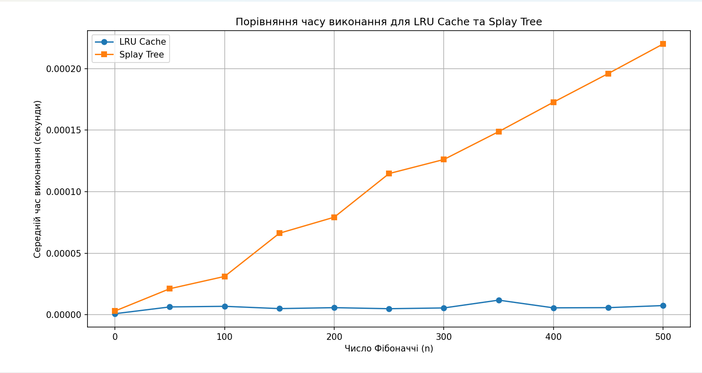

# goit-algo2-hw-07

## Fibonacci benchmark: LRU cache versus splay tree

| n   | LRU Cache Time (s)  | Splay Tree Time (s) |
|-----|---------------------|---------------------|
| 0   | 0.0000009000        | 0.0000030800        |
| 50  | 0.0000064000        | 0.0000212000        |
| 100 | 0.0000069000        | 0.0000311800        |
| 150 | 0.0000050400        | 0.0000662800        |
| 200 | 0.0000058000        | 0.0000793000        |
| 250 | 0.0000049600        | 0.0001147400        |
| 300 | 0.0000055800        | 0.0001261800        |
| 350 | 0.0000119200        | 0.0001488200        |
| 400 | 0.0000056600        | 0.0001727600        |
| 450 | 0.0000058200        | 0.0001960400        |
| 500 | 0.0000075000        | 0.0002200400        |

The LRU-cache implementation was substantially faster in this experiment. Most recorded `fibonacci_lru(n)` calls remained around 5–7 microseconds, with a higher value around n = 350. CPython's `@lru_cache` efficiently memoizes recursive calls.

The splay-tree implementation became slower as n increased: approximately 21 μs at n = 50, 115 μs at n = 250, and 220 μs at n = 500. Lookup and insertion require tree rotations even when a value has already been calculated.

For this Fibonacci workload, the LRU cache is the better performance choice. A splay tree offers different flexibility: complex keys, dynamic cache changes, and keeping frequently accessed keys near the root.
