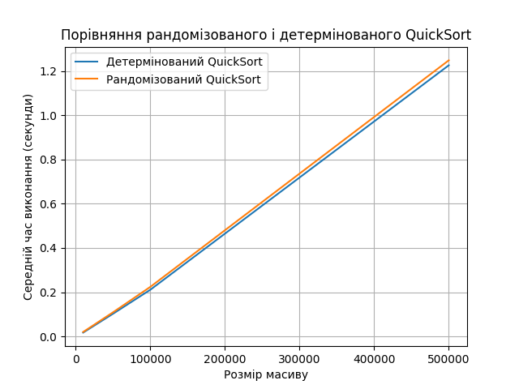

# goit-algo2-hw-10

## Task 1: randomized versus deterministic QuickSort

| Array size | Randomized QuickSort, seconds | Deterministic QuickSort, seconds |
|---:|---:|---:|
| 10000 | 0.0202 | 0.0174 |
| 50000 | 0.1092 | 0.1025 |
| 100000 | 0.2241 | 0.2111 |
| 500000 | 1.2488 | 1.2262 |

Both variants had similar performance on these random arrays. The deterministic middle-pivot variant was slightly faster in every recorded test, with differences decreasing at larger sizes.

Poor pivot choices can produce O(n²) behavior. Randomization reduces sensitivity to input order, although duplicate-heavy inputs also depend on the partition implementation.

## Task 2: greedy class scheduling

The sample schedule selects:

| Teacher | Age | Example email | Subjects |
|---|---:|---|---|
| Nataliia Shevchenko | 29 | n.shevchenko@example.com | Biology, Chemistry |
| Dmytro Bondarenko | 35 | d.bondarenko@example.com | Computer Science, Physics |
| Oleksandr Ivanenko | 45 | o.ivanenko@example.com | Mathematics |
