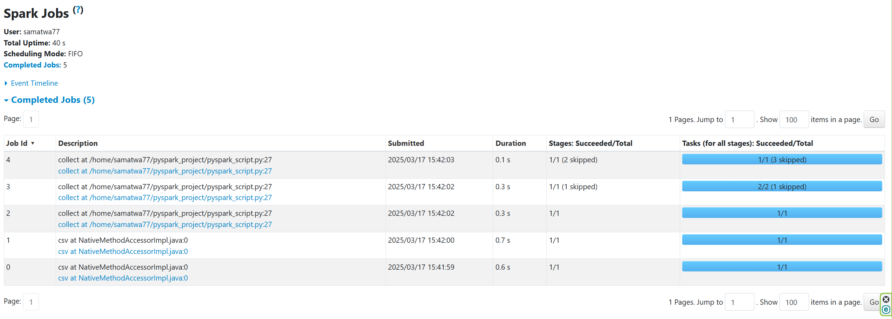
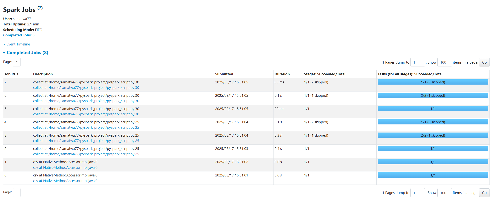
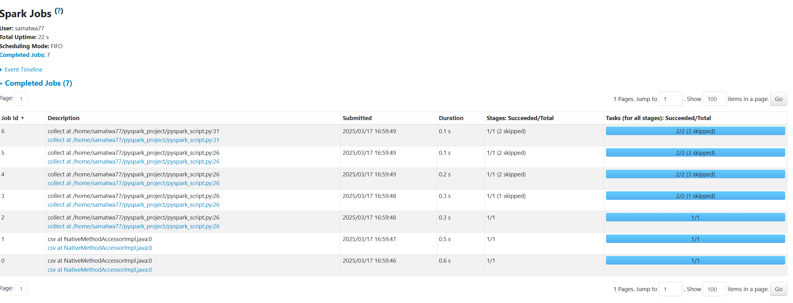

# goit-de-hw-04

## Part 1

The recorded Spark UI run shows these stages of work:

1. Infer the CSV schema using `.option("inferSchema", "true")`.
2. Read CSV, apply `.where("final_priority < 3")`, select `unit_id` and `final_priority`, and prepare the map stage.
3. Shuffle by `unit_id` and aggregate each group's `count()`.
4. Apply the post-aggregation filter `.where("count>2")`.
5. Collect the final results to the driver.

Job boundaries and counts describe the recorded run and can vary with Spark execution settings.

## Part 2: two actions without caching

The recorded run contains eight jobs:

1. CSV schema inference.
2. CSV reading, filtering, selection and shuffle preparation for the first `.collect()`.
3. Shuffle, grouping and count for the first action.
4. Collection of the grouped results.
5. Repeated reading, filtering, selection and shuffle preparation for the second action.
6. Repeated shuffle and aggregation.
7. The additional `.where("count>2")` filter.
8. The second collection to the driver.

### Why does an intermediate collect add work?

The additional `nuek_processed.collect()` triggers an action. Without caching, subsequent actions can recompute the preceding transformations. In this example, reading and grouping occur twice, adding three recorded jobs.

## Part 3: cached intermediate results

The recorded run contains seven jobs:

1. Infer CSV column types.
2. Read, filter and select the input; prepare grouping by `unit_id`.
3. Shuffle, group and count.
4. Materialize the cached result during execution.
5. Perform the first `.collect()`.
6. Apply `.where("count>2")` to the cached result.
7. Perform the second `.collect()`.

### Why does caching reduce repeated work?

`cache()` is lazy and is materialized by an action. Once materialized, later actions can reuse the intermediate result instead of rereading and regrouping the CSV. Initial caching itself adds work, but avoids repeated upstream execution in this experiment.
