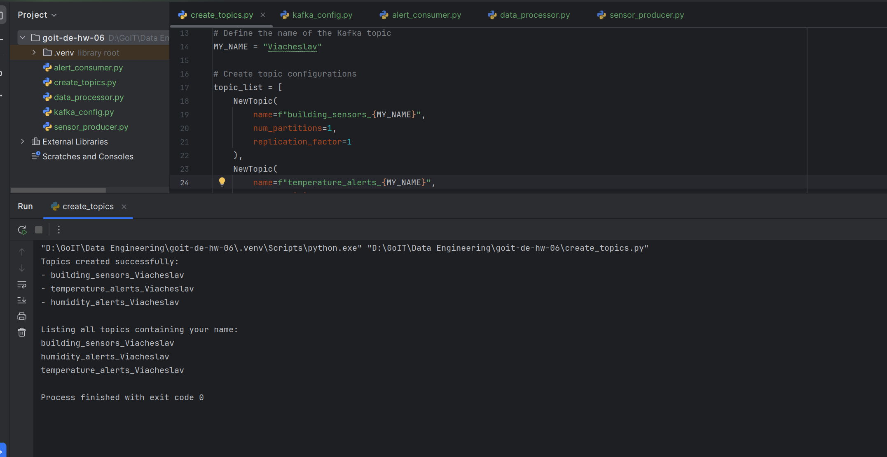
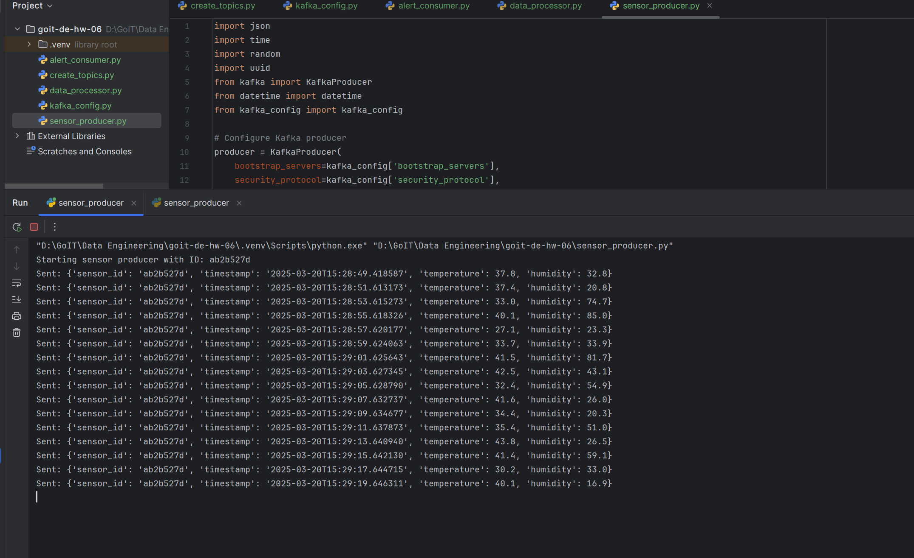
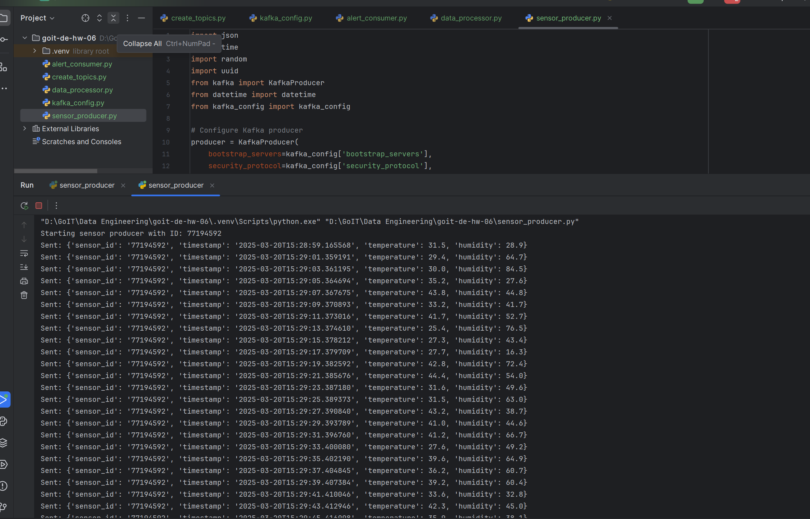
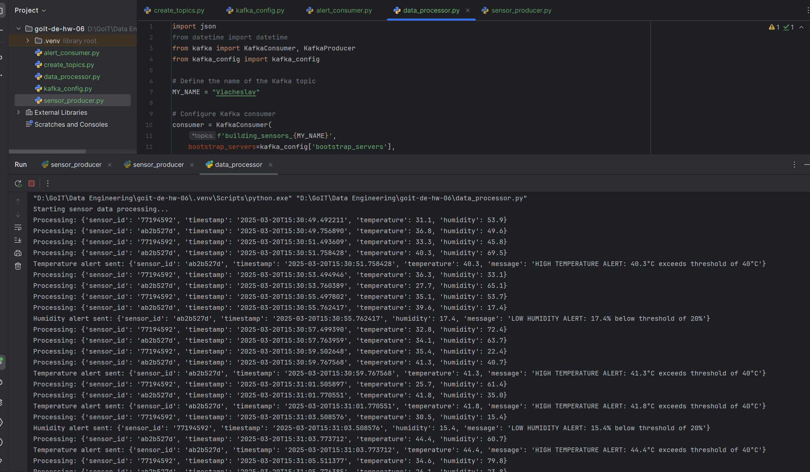
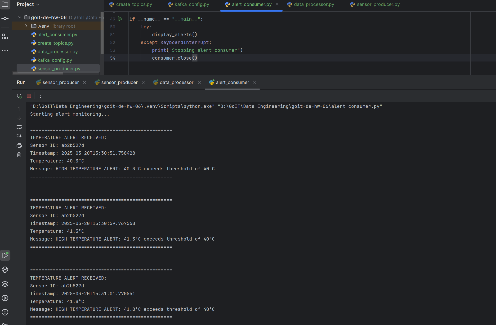

# goit-de-hw-05

## Three Kafka topics

## Concurrent sensor producers

Two program instances generate sensor readings and send them to `building_sensors`.

## Processing and routing

The processor receives readings, selects the required data and forwards it to the relevant topics.

## Filtered output

