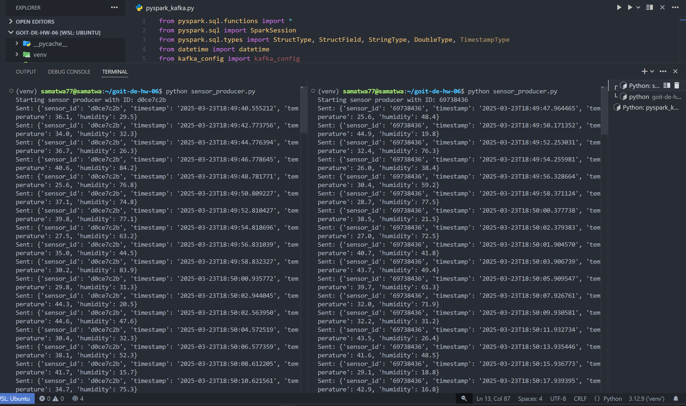
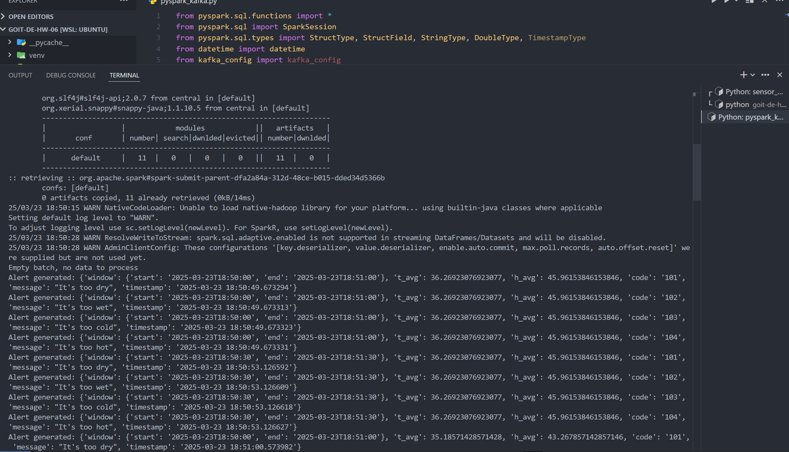

# goit-de-hw-06

## Concurrent sensor-data generation

Two producer instances generate readings and send them to `building_sensors`.

## Filtered-topic output

Filtered records are sent to their corresponding Kafka topics.

