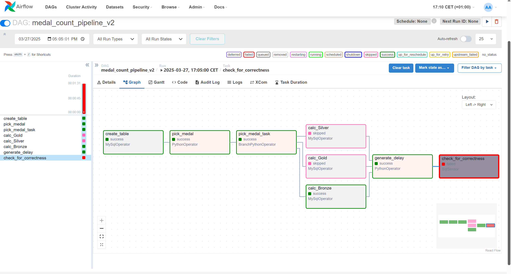
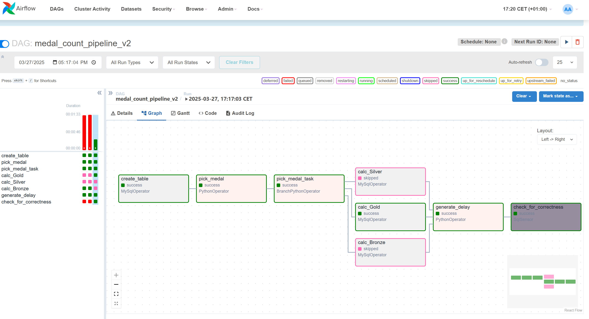
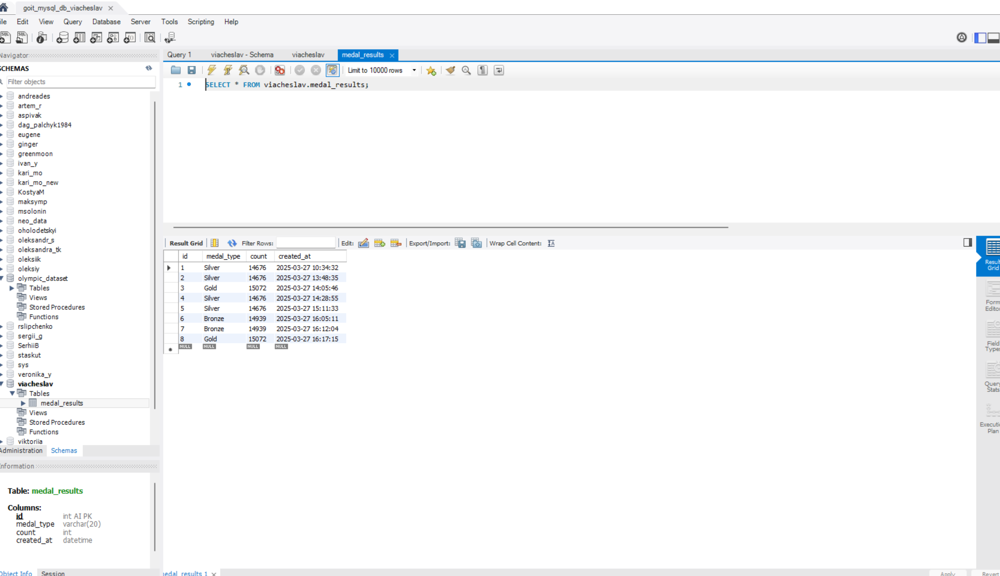

# goit-de-hw-07

## 1. Delay = 35 seconds

The sensor timed out because `generate_delay` deliberately used `sleep(35)`, while the record had to be checked within 30 seconds. This demonstrates the expected timeout behavior and DAG delay check.

## 2. Delay = 10 seconds

The sensor succeeded: the record in `viacheslav.medal_results` was no more than 30 seconds old. After `time.sleep(10)`, `SqlSensor` found the fresh value and returned `True`.

## 3. MySQL Workbench

