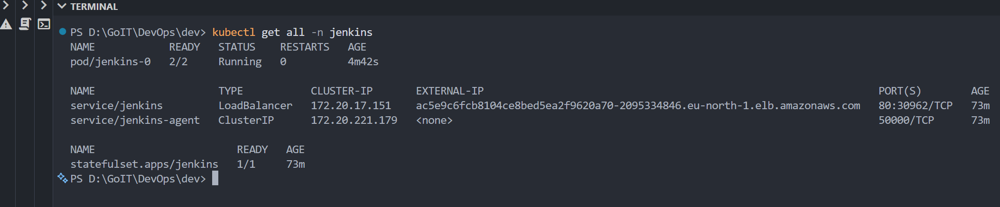
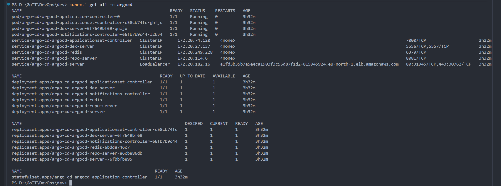
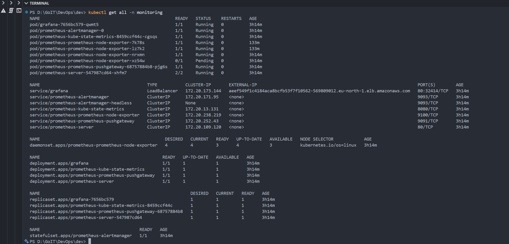
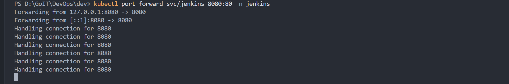
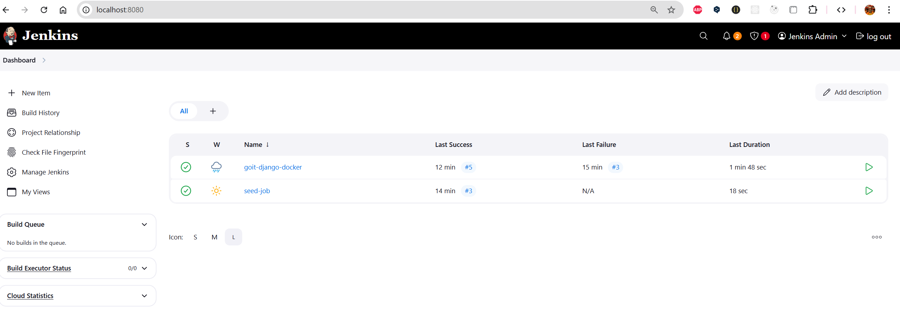
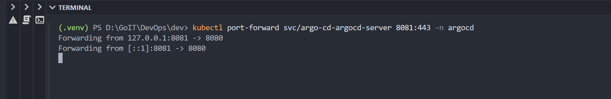
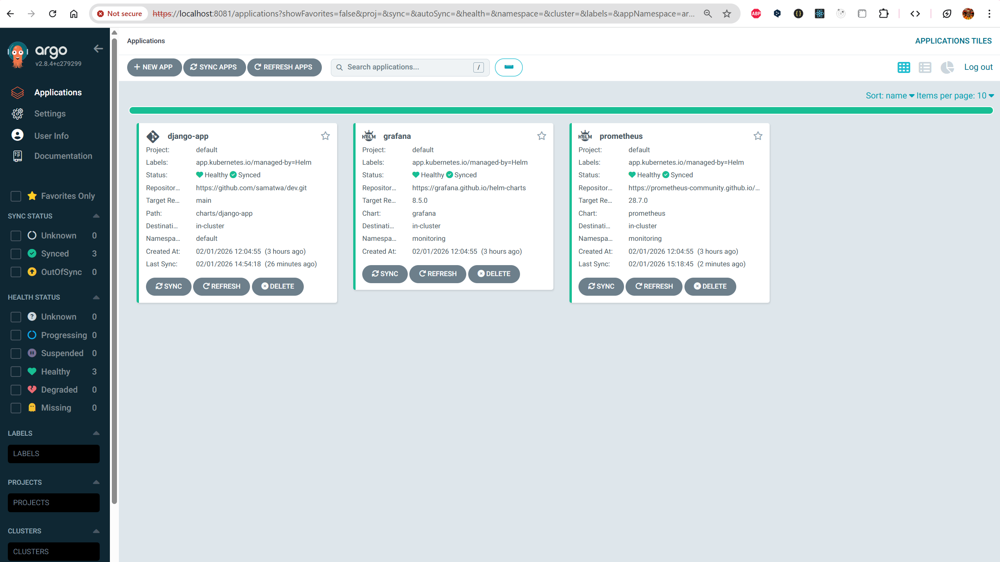
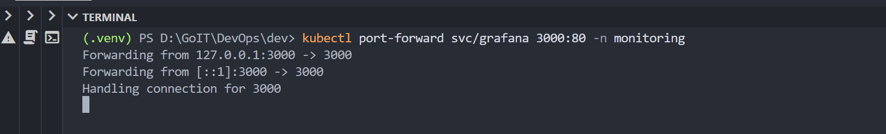
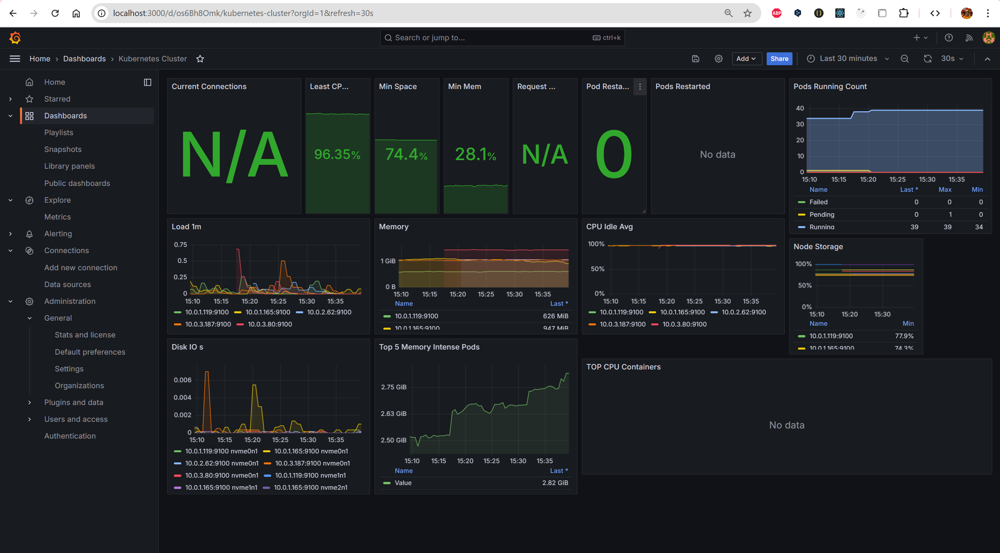

# DevOps final project: AWS cloud infrastructure and GitOps

Terraform provisions AWS infrastructure, while Argo CD and Jenkins implement GitOps and CI/CD. Prometheus and Grafana provide monitoring.

## Architecture

- VPC with public and private subnets.
- EKS managed Kubernetes cluster.
- RDS or Aurora PostgreSQL database.
- ECR container-image registry.
- Jenkins build automation.
- Argo CD application deployment.
- Prometheus and Grafana metrics and visualization.

## Repository structure

```text
Project/
│
├── main.tf
├── backend.tf
├── outputs.tf
│
├── modules/
│  ├── s3-backend/
│  │  ├── s3.tf
│  │  ├── dynamodb.tf
│  │  ├── variables.tf
│  │  └── outputs.tf
│  │
│  ├── vpc/
│  │  ├── vpc.tf
│  │  ├── routes.tf
│  │  ├── variables.tf
│  │  └── outputs.tf
│  │
│  ├── ecr/
│  │  ├── ecr.tf
│  │  ├── variables.tf
│  │  └── outputs.tf
│  │
│  ├── eks/
│  │  ├── eks.tf
│  │  ├── aws_ebs_csi_driver.tf
│  │  ├── node.tf
│  │  ├── variables.tf
│  │  └── outputs.tf
│  │
│  ├── rds/
│  │  ├── rds.tf
│  │  ├── aurora.tf
│  │  ├── shared.tf
│  │  ├── variables.tf
│  │  └── outputs.tf
│  │ 
│  ├── jenkins/
│  │  ├── jenkins.tf
│  │  ├── Jenkinsfile
│  │  ├── variables.tf
│  │  ├── providers.tf
│  │  ├── values.yaml
│  │  └── outputs.tf
│  │ 
│  └── argo_cd/
│    ├── argocd.tf
│    ├── variables.tf
│    ├── providers.tf
│    ├── values.yaml
│    ├── outputs.tf
│    └── charts/
│      ├── Chart.yaml
│      ├── values.yaml
│      └── templates/
│        ├── application.yaml
│        ├── repository.yaml
│        └── prometheus-extra-rbac.yaml
│
├── charts/
│  └── django-app/
│    ├── templates/
│    ├── Chart.yaml
│    └── values.yaml
│
└── Django/
    ├── app/
    ├── Dockerfile
    ├── Jenkinsfile
    ├── manage.py
    ├── requirements.txt
    └── docker-compose.yaml
```

The `s3-backend` module provides Terraform state storage; `vpc` supplies networking; `ecr` supplies the image registry; `eks` includes the EBS CSI driver; `rds` configures the database; `jenkins` and `argo_cd` install the Helm-based automation stack. The Argo CD chart describes Prometheus, Grafana and the Django application. `Django/` contains application code and its build files.

## Setup

Install Terraform, kubectl, Helm and the AWS CLI. Configure AWS access with `aws configure`.

```powershell
terraform init
terraform apply
```

After provisioning, which took approximately 15–20 minutes in the original exercise, inspect the namespaces:

```powershell
kubectl get all -n jenkins
kubectl get all -n argocd
kubectl get all -n monitoring
```





## Access the tools

Port-forward commands are also included in Terraform outputs.

| Tool | Command | URL |
|---|---|---|
| Jenkins | `kubectl port-forward svc/jenkins 8080:80 -n jenkins` | http://localhost:8080 |
| Argo CD | `kubectl port-forward svc/argo-cd-argocd-server 8081:443 -n argocd` | https://localhost:8081 |
| Grafana | `kubectl port-forward svc/grafana 3000:80 -n monitoring` | http://localhost:3000 |
| Prometheus | `kubectl port-forward svc/prometheus-server 9090:80 -n monitoring` | http://localhost:9090 |








Argo CD uses the `admin` account with an automatically generated password stored in a Kubernetes secret. The exercise's example Grafana credentials are `admin` / `admin123`.

## Monitoring

Node Exporter and cAdvisor collect node and container metrics. Grafana is configured with Prometheus as a data source.

## Database variables

| Variable | Description | Type | Default |
|---|---|---|---|
| `name` | Resource prefix for security, parameter and subnet groups | `string` | — |
| `use_aurora` | Aurora cluster when true; RDS instance when false | `bool` | `false` |
| `engine` | RDS database engine | `string` | `"postgres"` |
| `engine_cluster` | Aurora database engine | `string` | `"aurora-postgresql"` |
| `engine_version` | RDS engine version | `string` | `"14.7"` |
| `engine_version_cluster` | Aurora engine version | `string` | `"15.3"` |
| `instance_class` | Database instance size | `string` | `"db.t3.micro"` |
| `allocated_storage` | RDS disk capacity in GB | `number` | `20` |
| `db_name` | Initial database name | `string` | — |
| `username` | Administrator login | `string` | — |
| `password` | Sensitive administrator password | `string` | — |
| `vpc_id` | VPC used for the security group | `string` | — |
| `subnet_private_ids` | Private subnet-group IDs | `list(string)` | — |
| `subnet_public_ids` | Public subnet IDs when publicly accessible | `list(string)` | — |
| `publicly_accessible` | Allow database access from public networks | `bool` | `false` |
| `multi_az` | Multi-AZ availability | `bool` | `false` |
| `parameters` | Custom parameter-group settings | `map(string)` | `{}` |

## Configuration changes

Use `use_aurora` to select a cluster or ordinary RDS instance. Change `engine` or `engine_cluster` together with the corresponding `parameter_group_family_rds` or `parameter_group_family_aurora`. Adjust `instance_class` for CPU and memory capacity.

The module creates a parameter group and accepts custom entries through `parameters`, in addition to defaults such as `max_connections`, `log_statement` and `work_mem`.
