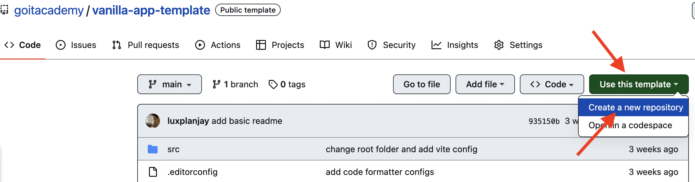
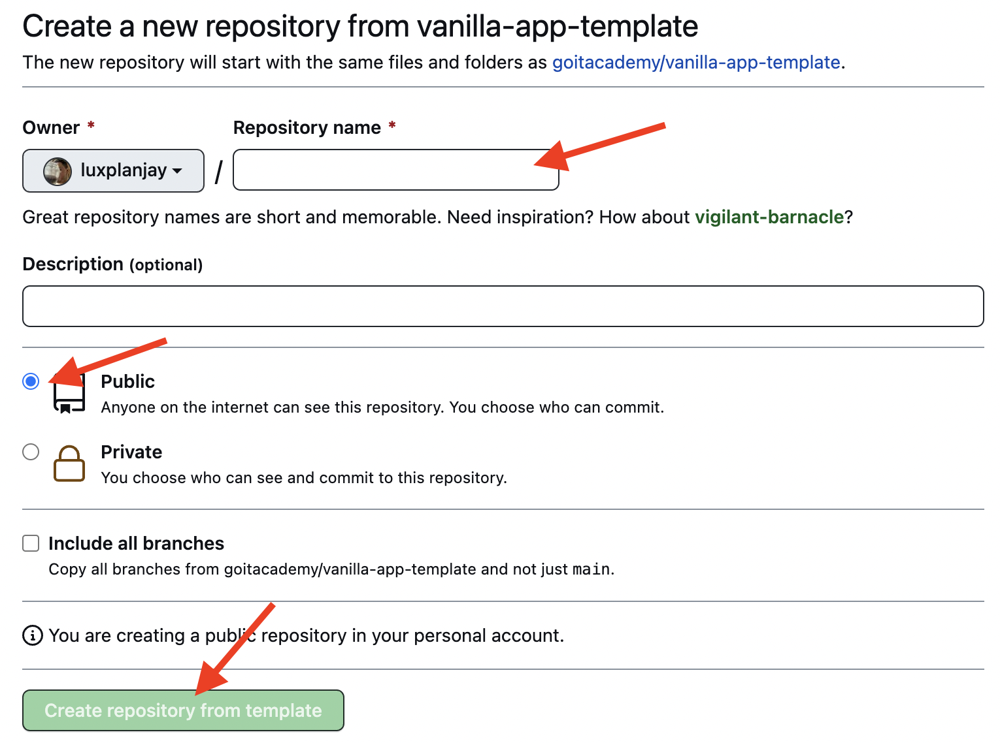
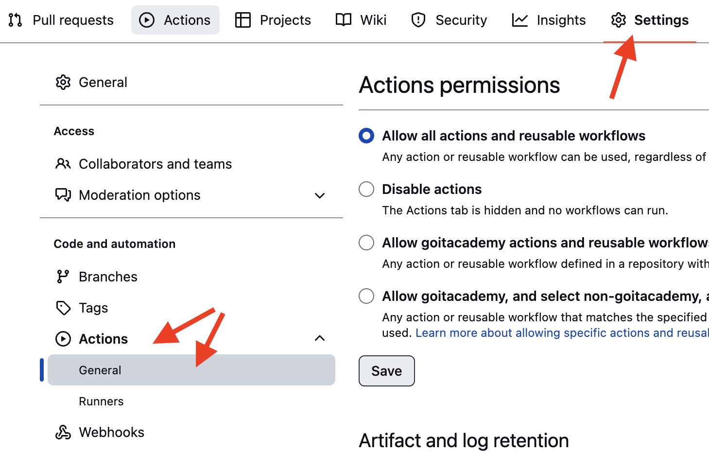
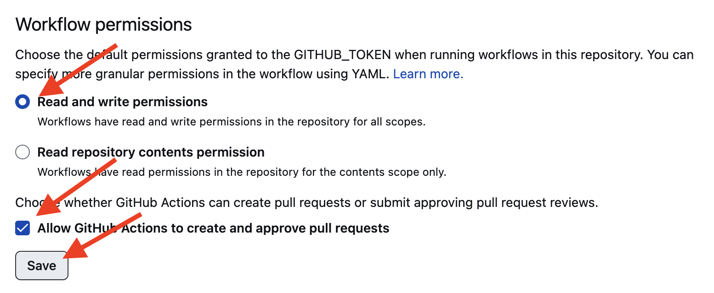
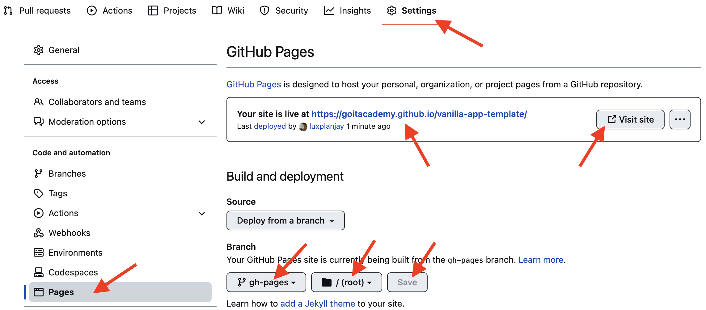
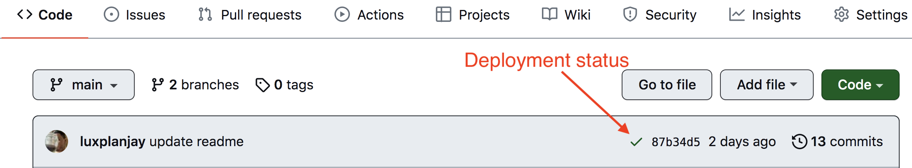
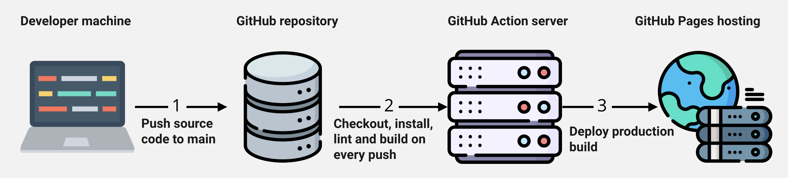

# Vanilla app template

This project uses Vite. See the [Vite documentation](https://vitejs.dev/) for configuration and additional features.

## Create a project from the template

In the original template repository, choose **Use this template → Create a new repository**, enter a repository name, select public visibility and choose **Create repository from template**.




The original exercise configures **Settings → Actions → General → Workflow permissions → Read and write permissions** for automated deployment. Configure only the permissions required by the workflow you use.




Clone the resulting repository and use the normal edit, commit and push workflow. This directory is the consolidated copy; the separate Pages repository is retained while its published site is in use.

## Development

1. Install a supported Node.js LTS release from [nodejs.org](https://nodejs.org/en/).
2. Install dependencies with `npm install`.
3. Start development with `npm run dev`.
4. Open [http://localhost:5173](http://localhost:5173). Vite reloads the page after source changes.

## Files and directories

Page fragments belong in `src/partials` and are imported into `index.html`; for example, create `partials/header.html` for the header. Styles belong in `src/css` and are imported by their HTML pages; the main page uses `index.css`. Images belong in `src/img`. The original deployment pipeline optimizes images during the production build.

## GitHub Pages deployment

In the standalone Pages repository, pushes or merged pull requests to `main` trigger the production build and publish it to `gh-pages`. Set the build base to the standalone repository name:

```json
"build": "vite build --base=/<REPO>/"
```

Under **Settings → Pages**, configure `gh-pages` and its `/(root)` directory if necessary.



### Deployment status

The commit status is yellow while building, green after success, or red after a lint, build or deployment failure. Open **Details** to inspect a failed run.



### Published page

The published URL appears in **Settings → Pages**, usually a few minutes after deployment. The upstream template example is [goitacademy.github.io/vanilla-app-template](https://goitacademy.github.io/vanilla-app-template/).

If the page is blank, inspect the browser console for CSS/JavaScript 404 errors and check `--base` in `package.json`.

## Pipeline overview



In the standalone repository, `.github/workflows/deploy.yml` checks out the project, installs dependencies, lints and builds it, then publishes the output to `gh-pages`. Failures are recorded in the workflow log. This workflow is nested inside the GoIT collection and does not deploy from this copy automatically.
